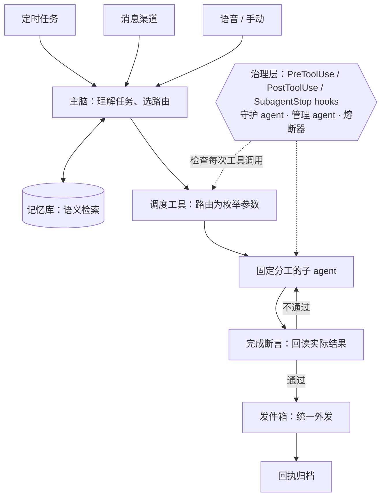

# 小戴 AI · 公开作品集

小戴是一个常驻运行的多 agent 运营系统，基于 Claude 原生工具调用构建，每天处理餐饮外卖的经营分析、营销、门店运营与交付核验。核心理念：**靠架构保证，不靠模型记。**

这个仓库是它的公开作品集。所有数据、品牌和案例均为合成或虚构示例，不包含系统源码和真实业务数据。

**在线浏览：[中文](https://cosmodai.github.io/xiaodai-ai-showcase/) · [English](https://cosmodai.github.io/xiaodai-ai-showcase/?lang=en)**

## 运行数据

统计自小戴自己的运行账本，截至 2026-11-06：自 5 月 27 日起连续运行 163 天，派单给子 agent 4,348 次；9 月 28 日起定时任务运行 21,857 次（107 个任务，96.9% 一次成功）；9 月 4 日起 25,247 次对外发送经过完成闸。详见[首页运行数据与时间线](https://cosmodai.github.io/xiaodai-ai-showcase/#numbers)。

## 架构一览

## 在线演示

| 演示 | 内容 | 语言 |
| --- | --- | --- |
| [执行轨迹回放](https://cosmodai.github.io/xiaodai-ai-showcase/trace.html) | 逐步回放一次定时任务：派单、hook 拦截、断言回读、回执归档；关掉完成断言可对比“假完成” | 中 / [EN](https://cosmodai.github.io/xiaodai-ai-showcase/trace.html?lang=en) |
| [转化漏斗诊断](https://cosmodai.github.io/xiaodai-ai-showcase/funnel.html) | 按区域和时段定位曝光到支付的转化掉点 | 中 / [EN](https://cosmodai.github.io/xiaodai-ai-showcase/funnel.html?lang=en) |
| [店铺装修诊断](https://cosmodai.github.io/xiaodai-ai-showcase/storefront.html) | 虚构店铺的改版前后与四项验收 | 中 / [EN](https://cosmodai.github.io/xiaodai-ai-showcase/storefront.html?lang=en) |
| [数据导入质检](https://cosmodai.github.io/xiaodai-ai-showcase/import.html) | 重现保留旧值的问题，应用修正并回读校验 | 中 |
| [营销活动情景模拟](https://cosmodai.github.io/xiaodai-ai-showcase/campaign.html) | 调整订单量和每单补贴，查看成本与贡献变化 | 中 |

## 其他内容

| 板块 | 内容 |
| --- | --- |
| [小戴怎么运作](https://cosmodai.github.io/xiaodai-ai-showcase/#how) | 架构图和四条设计原则 |
| [回读核验专题](https://cosmodai.github.io/xiaodai-ai-showcase/#verify) | “保存 ≠ 生效、发送 ≠ 送达”的四个案例 |
| [能力地图与案例](https://cosmodai.github.io/xiaodai-ai-showcase/#capabilities) | 16 个业务场景，各配一个合成数据案例 |
| [视觉作品](https://cosmodai.github.io/xiaodai-ai-showcase/#creative) | 虚构品牌 Maple Wok 的菜品图、海报、项目封面与菜品图验收流程 |
| [公开 Skills](skills/) | 五个可直接用于 Claude Code 的工作流，附可复算示例 |
| [工程复盘](docs/) | [路由必须走类型化参数](docs/01-routing-must-be-typed.md) · [假完成](docs/02-phantom-done.md) · [用事故数据修正熔断器](docs/03-circuit-breaker-from-incident-data.md)（另有[英文版](docs/en/)） |

## 本地运行

纯 HTML、CSS 和 JavaScript，没有构建步骤。下载仓库后用浏览器打开 `index.html` 即可。

## 核对示例

- 导入质检：北区原费用 120.00，上游修正为 95.00。保留旧记录后回读仍为 120.00。应用修正后回读为 95.00，南区保持 80.00。
- 营销模拟：100 单、每单补贴 2.00 时，成本为 200.00，示例贡献为 400.00。每单补贴改为 3.00 后，成本为 300.00，示例贡献为 300.00。
- 执行轨迹：开启完成断言时，第 6 步因数据截止日为 2026-10-25（要求 2026-11-01）被退回；关闭时同一份过期报告被投递并归档为完成。
- 漏斗诊断：全部区域、全部时段下，进店到加购由 50.0% 降到 44.7%，是降幅最大的环节（−5.3 个百分点）。

情景模拟的页面设计参考 [QuantFin-AnalyticX](https://github.com/mirabelleding/QuantFin-AnalyticX) 的交互思路。

---

## English

**Xiaodai** is a persistent multi-agent operations system built on Claude's native tool use. It runs daily analytics, marketing, store operations and delivery verification for a food-delivery business. Its guiding principle: *guarantees come from architecture, not from the model remembering rules.*

- A coordinator routes work to fixed-role subagents through a dispatch tool whose route is a typed enum, so hooks can enforce it. Free-text routing never reaches a hook.
- A governance layer (PreToolUse / PostToolUse / SubagentStop hooks, a guardian agent, a manager agent, hysteresis circuit breakers) checks every tool call.
- A subagent saying "done" is only a claim. Each task type has machine-checkable completion assertions that read back the real-world result; external messages go through an outbox and close only on a matching receipt.

Running on a live business since May 27, 2026: 4,348 subagent dispatches, 21,857 scheduled job runs since Sep 28 (96.9% first-try success), and 25,247 outgoing sends checked by the completion gate since Sep 4, counted from its own ledgers.

**Browse:** [English portfolio](https://cosmodai.github.io/xiaodai-ai-showcase/?lang=en) · [Execution trace replay](https://cosmodai.github.io/xiaodai-ai-showcase/trace.html?lang=en) · [Funnel diagnostics](https://cosmodai.github.io/xiaodai-ai-showcase/funnel.html?lang=en) · [Storefront audit](https://cosmodai.github.io/xiaodai-ai-showcase/storefront.html?lang=en) · [Public skills](skills/) · [Engineering notes](docs/en/)

All data, brands and examples are synthetic or fictional. No source code or real business data is included.
