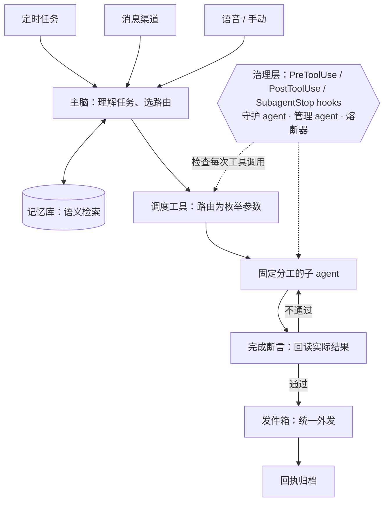

# 小戴 AI · 公开作品集

小戴是一个常驻运行的多 agent 运营系统，基于 Claude 原生工具调用构建，每天处理餐饮外卖的经营分析、营销、门店运营与交付核验。核心理念：**靠架构保证，不靠模型记。**

这个仓库是它的公开作品集。所有数据、品牌和案例均为合成或虚构示例，不包含系统源码和真实业务数据。

在线浏览：https://cosmodai.github.io/xiaodai-ai-showcase/

## 架构一览

## 内容

| 板块 | 内容 |
| --- | --- |
| [小戴怎么运作](index.html#how) | 架构图和四条设计原则 |
| [执行轨迹回放](trace.html) | 逐步回放一次定时任务：派单、hook 拦截、断言回读、回执归档；可关掉完成断言对比“假完成” |
| [数据导入质检](import.html) | 对比历史值与上游修正，重现保留旧值的问题，应用修正并回读校验 |
| [营销活动情景模拟](campaign.html) | 调整订单量和每单补贴，即时查看成本、示例贡献和相对基准的变化 |
| [回读核验专题](index.html#verify) | 四个“保存 ≠ 生效、发送 ≠ 送达”的案例 |
| [能力地图与案例](index.html#capabilities) | 16 个业务场景，各配一个合成数据案例 |
| [视觉作品](index.html#creative) | 虚构品牌 Maple Wok 的菜品图、海报与项目封面 |
| [工程复盘](docs/) | [路由必须走类型化参数](docs/01-routing-must-be-typed.md) · [假完成](docs/02-phantom-done.md) · [用事故数据修正熔断器](docs/03-circuit-breaker-from-incident-data.md) |

## 运行

页面只用 HTML、CSS 和 JavaScript，没有构建步骤。下载仓库后用浏览器打开 `index.html` 即可，GitHub Pages 也可以直接从默认分支根目录托管。

## 核对示例

- 导入质检：北区原费用 120.00，上游修正为 95.00。保留旧记录后回读仍为 120.00。应用修正后回读为 95.00，南区保持 80.00。
- 营销模拟：100 单、每单补贴 2.00 时，成本为 200.00，示例贡献为 400.00。每单补贴改为 3.00 后，成本为 300.00，示例贡献为 300.00。订单量由使用者输入。
- 执行轨迹：开启完成断言时，第 6 步因数据截止日为 2026-10-25（要求 2026-11-01）被退回；关闭时同一份过期报告被投递并归档为完成。

情景模拟的页面设计参考 [QuantFin-AnalyticX](https://github.com/mirabelleding/QuantFin-AnalyticX) 的交互思路。

---

## English

**Xiaodai** is a persistent multi-agent operations system built on Claude's native tool use. It runs daily analytics, marketing, store operations and delivery verification for a food-delivery business. Its guiding principle: *guarantees come from architecture, not from the model remembering rules.*

- A coordinator ("main brain") routes work to fixed-role subagents through a dispatch tool whose route is a typed enum, so hooks can enforce it. Free-text routing never reaches a hook.
- A governance layer (PreToolUse / PostToolUse / SubagentStop hooks, a guardian agent, a manager agent, hysteresis circuit breakers) checks every tool call.
- A subagent saying "done" is only a claim. Each task type has machine-checkable completion assertions that read back the real-world result; external messages go through an outbox and close only on a matching receipt.

This repo is a public portfolio: interactive demos (including an [execution trace replay](trace.html) that contrasts runs with and without completion assertions), case studies on synthetic data, and short [engineering write-ups](docs/). Page text is in Chinese. No source code or real business data is included.
